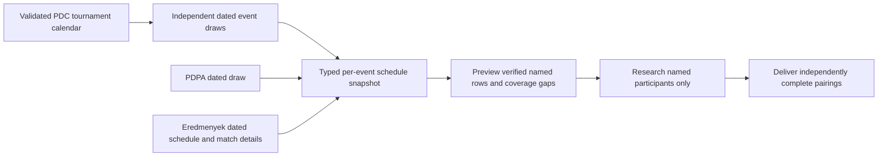
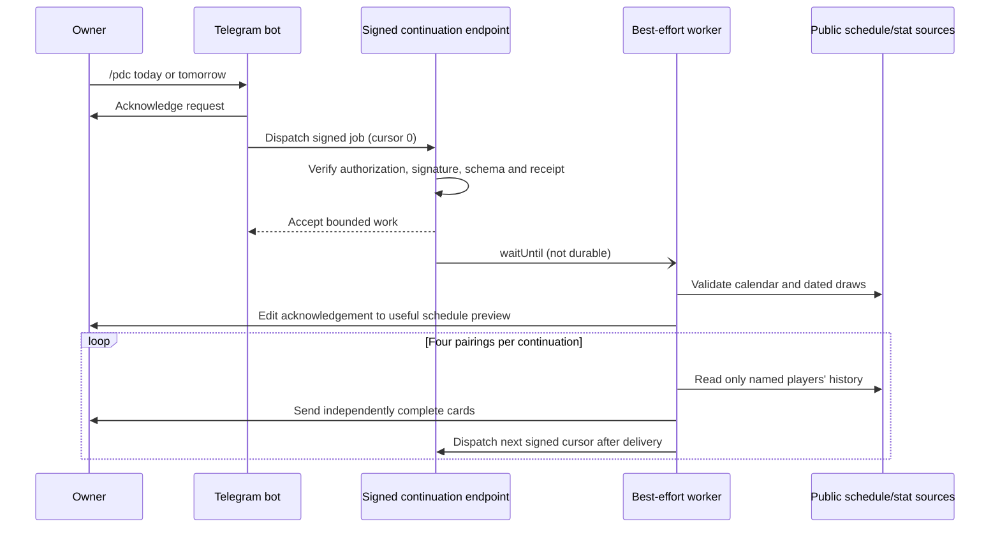

# Current PDC schedule and report architecture

**Status:** reflects the implementation in this repository as of 14 October 2026. It supersedes the earlier API-only and fixture-corroboration flow described in older PDC investigations; those documents remain historical evidence, not the current runbook.

## Why schedule and results are separate

`/pdc latest` answers “what finished most recently?” with the DartsOrakel completed-event calendar and result pages. `/pdc today` and `/pdc tomorrow` answer “what is scheduled?” with a different pipeline. A future event has no completed result page, so treating the completed-event source as proof of an empty future schedule repeats the original category error.

## Schedule acquisition

- Validate calendar pagination and the complete calendar response before interpreting an empty date as verified empty scope.
- Read event fixtures independently with bounded concurrency. A failed or malformed event is isolated; validated event rows remain available.
- Preserve explicit unassigned opponent slots as a count. An unknown count is `null`, not zero. An empty or malformed fixture response does not prove that a draw is unpublished.
- Try dated PDPA rows for unresolved coverage. If an event is in the validated PDC calendar but still lacks pairings, try Eredmenyek once for the unresolved event set and verify each candidate against its dated match detail. Do not pull unrelated competition rows into the slate.
- Merge only after an unambiguous event mapping. Keep existing source rows; cross-source deduplication requires the same date, event, non-null round and exact two-player identity. A missing round or ambiguous event does not authorize collapsing fixtures.
- Retain provider-backed player labels for the preview. Directory identity resolution belongs to statistics research, not schedule display. The optional Darts Nerd feed is not on the first-preview path.
- Keep provider time semantics: offset-bearing live timestamps can be rendered in Europe/Budapest; a bare official time is not silently converted to UTC.

The snapshot is a versioned Zod-validated value with the requested date, Budapest time-zone label, observation time, calendar status, event coverage, named fixtures, pending slots, bounded reasons and evidence URLs. `available` means the configured source returned validated named rows without an observed gap; it is not a guarantee that the source lists every real-world match.

## On-demand workflow without a database

- The job payload carries the validated schedule snapshot, fixtures, cursor and known delivery counts. That makes each continuation self-contained and lets the worker reject changed participants; it does not survive a lost continuation unless a caller still has and resubmits that payload.
- `CacheStore` is an injected cache-aside port. Local execution uses file cache; Vercel uses bounded memory cache. Neither cache is authoritative evidence storage, shared coordination, or crash recovery.
- The continuation endpoint depends on `PdcJobReceiptStore`. Today its implementation is an in-memory, per-process adapter with a 1,024-entry bound and one-hour expiry. Its atomic `reserve` method prevents warm-instance duplicate scheduling; a separate `get` then `set` would not preserve that property. Multiple instances and restarts still have independent receipts.
- Current stages favor visible value over hidden work: acknowledge → resolve and preview schedule → research only named pairings in bounded sequential chunks → report complete/withheld counts. No PDC request runs on a timer, and there is no unsolicited report.
- On receipt-store or scheduler admission failure, the endpoint fails closed rather than running untracked work. If a background invocation is terminated after returning `202`, there is no durable worker to find or resume it; the user may have to request the report again.

This is deliberately a modular-monolith flow: the domain schedule/research code depends on small cache, receipt, source, sender and dispatcher contracts; Vercel handlers compose concrete adapters at the edge. The current worker does not know a database driver or SQL schema.

## Reuse and cancellation

- Cache the PDC calendar and each date's schedule separately. Calendar entries target 30 seconds; schedule snapshots target five minutes and keep their original `observedAt` on a cache hit.
- Local runs keep file-backed entries. Vercel uses a bounded per-process memory cache because the deployed filesystem is not durable or shared.
- Same-key concurrent misses share one in-flight acquisition. Each caller has independent cancellation; shared network work is aborted only after its last caller leaves.
- `/pdc latest` calendar requests use the same cancellation-safe coalescing behavior.
- These mechanisms reduce repeated work within one warm process. They do **not** provide cross-instance reuse, durable snapshots, or a global provider request budget.

## Telegram output and statistics policy

1. The owner command receives an acknowledgement. Once the schedule is known, the bot edits that message into the schedule preview; the preview lists named matchups and separately identifies pending or unavailable event coverage.
2. Only concrete named fixtures generate participant history requests. Pending slots never trigger guessed players or history lookups. Partial but named matches remain eligible even when another event is unresolved.
3. Statistics stay on the existing DartsOrakel research path and retain average, 180 and checkout evidence. Missing values remain unavailable; they are never replaced with zero.
4. A pairing is delivered only when both players have successful history results. A player's isolated failure withholds only dependent pairings, and later pairings continue. A schedule cursor is distinct from successful-card and failed-pairing counts.
5. Full reports use sequential batches of four and pin the same fixture snapshot into every continuation. A signed job authenticates the payload; it does not make delivery exactly-once.

Telegram sends are side effects: definitive rate limits may be retried within the existing policy, but ambiguous network delivery is not blindly retried. The status editor is a narrow Telegram adapter and does not create a second bot instance.

## Deliberate infrastructure boundary

The current report continuation uses the existing signed endpoint and Vercel `waitUntil`, with process-local duplicate receipts. It is not a durable queue or admission/lease protocol. There is no shared database integration, cross-instance provider reservation, durable delivery record, or scheduled PDC prefetch. Those infrastructure releases were explicitly deferred; enabling them requires choosing and verifying an existing durable store and scheduler first. No production configuration or deployment is implied by this document.

### Future persistence path (not implemented)

Do not make the current `CacheStore` or receipt adapter pretend to be a durable job system. If pilot evidence justifies a database, introduce narrow application ports and database adapters in a separate release:

1. A typed snapshot repository for validated schedules and player history, keyed by provider and canonical identity, with schema version, observation/source times, coverage and content version. Refresh failure must preserve the last valid snapshot and must not relabel it as fresh.
2. A durable PDC job repository for atomic idempotent admission, bounded leases, fenced progress updates and resumable fixture/cursor state. The in-memory receipt port is only a seam for request deduplication; a database `reserve` alone would not close the crash window between admission and `waitUntil`. Durable work needs an atomic admission/claim protocol and a worker that can poll or otherwise resume accepted jobs.
3. A delivery ledger with `pending`, `sending`, `sent`, `failed` and `uncertain` states. A timeout after Telegram accepted a send must remain uncertain; a database cannot make an external Telegram side effect exactly once.
4. A provider-scoped reservation/cooldown port only if measurements prove process-local pacing exceeds an authorized aggregate quota. Do not hold a database transaction open across network requests.

Use one verified store if it can satisfy both snapshot reuse and atomic work coordination. Add schema/version compatibility first, deploy compatible readers, then persist new writes; retain the signed-payload reader through its one-hour lifetime and rollback window. A later persistent adapter must have outage behavior and migration/rollback tests before the runtime selects it. Until those gates pass, keep the no-database workflow as the supported path.

Optional Jina transport tuning is also not enabled: account-specific quota and capacity were unavailable to verify. No higher concurrency or paid-key assumption is made.

## Verification and rollback

- `npm test` covers source isolation, pending slots, safe fallback merge, cancellation, Budapest date boundaries, schedule preview, player-failure isolation, job compatibility and sender behavior.
- `npm run build` checks strict TypeScript types.
- `npm run pdc:upcoming:smoke -- tomorrow --fixtures-only` performs bounded read-only schedule discovery without player-history fan-out or Telegram sends. Full-mode smoke may contact player-history sources but still does not send Telegram messages.
- No benchmark here is a production p95 claim; warm local cache and cold remote discovery are different conditions.

Roll back the schedule consumer or source-adapter change if it associates a player with the wrong event/match, claims verified empty scope after an incomplete calendar, loses already validated rows because a fallback failed, or hides a known-sent pairing. Keep older signed payloads readable during their one-hour TTL; a job without the new schedule field uses its pinned fixtures as explicitly partial legacy evidence.

## Feynman walkthrough

Think of the calendar as the list of cinemas open today, and each event draw as that cinema's actual screening list. A cinema existing does not tell us which film starts at 7; one unreadable screening list does not erase the other cinemas. First show the listings we can prove, mark the gaps honestly, and ask for player history only for screenings with two named players. If one player's research fails, withhold only that matchup card. This keeps “we could not verify it” from being confused with “nothing exists.”
